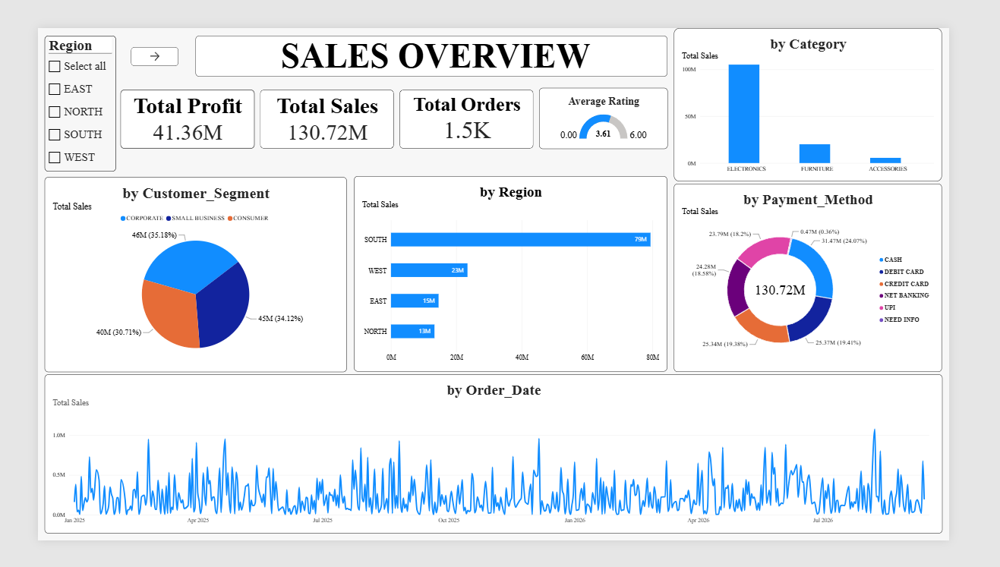
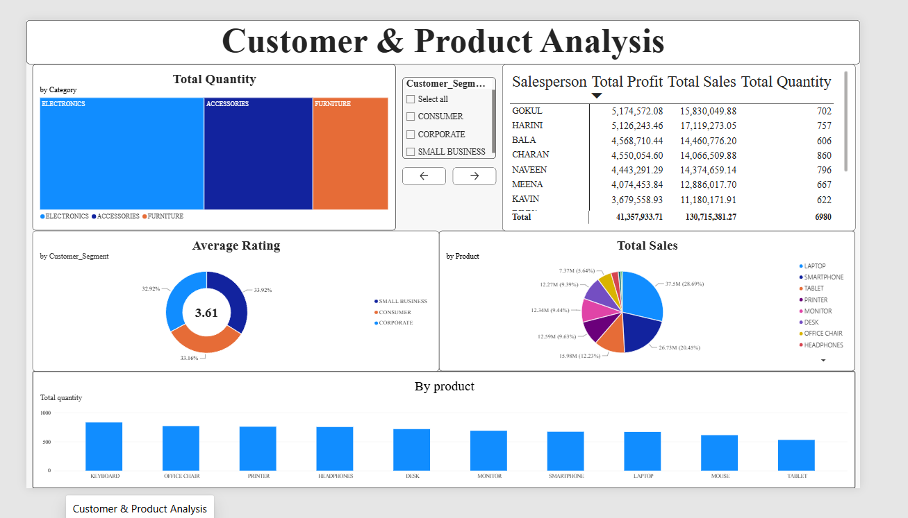
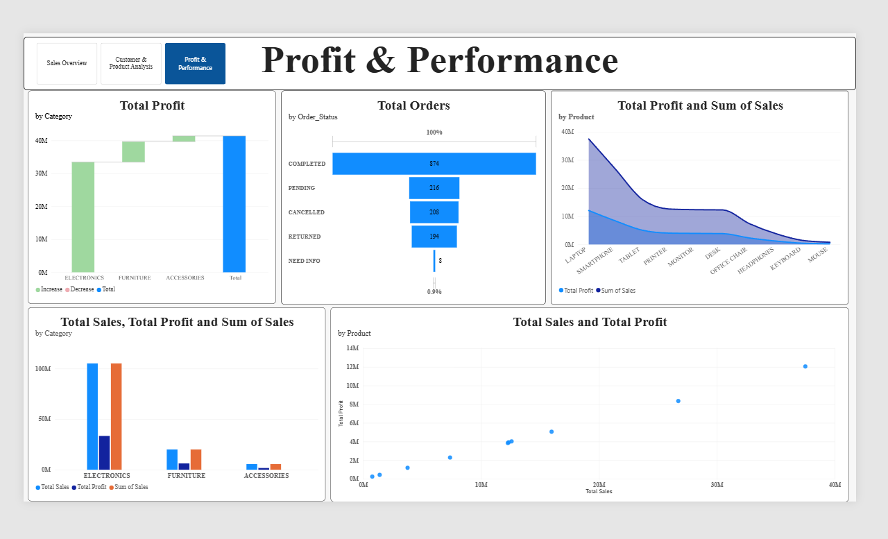

# 📊 Sales Performance & Profit Analytics Dashboard

An interactive **3-page Power BI Business Intelligence solution** analyzing **1,500+ sales transactions** representing **₹130.7M+ in total revenue** and **₹41.36M in total profit**.

---

## 📁 Repository Structure

- `data/Raw_Sales_Dataset.xlsx` — Cleaned raw sales dataset (1,515 order records).
- `screenshots/Page1_Sales_Overview.png` — Executive Sales & Financial KPI Overview.
- `screenshots/Page2_Customer_Product.png` — Salesperson Leaderboard & Product Analysis.
- `screenshots/Page3_Profit_Performance.png` — Order Status Funnel & Category Profitability Analysis.
- `Sales_Performance_Dashboard.pbix` — Interactive Power BI Desktop report file.

---

## 📈 Key Summary Metrics

- **Total Revenue Analyzed:** ₹130,715,381.27
- **Total Profit Generated:** ₹41,357,933.71
- **Total Order Volume:** 1,500+ Transactions
- **Average Customer Rating:** 3.61 / 5.00

---

## 📊 Interactive Dashboard Previews

### Page 1: Executive Sales Overview

### Page 2: Customer & Product Analysis

### Page 3: Profit & Performance

---

## 💡 Key Business Insights

1. **Geographic Dominance:** The **South region** is the top-performing territory, generating **₹79M+ (over 60%)** of overall company revenue.
2. **Category Leadership:** **Electronics** leads all product categories in both revenue and profit contribution compared to Furniture and Accessories.
3. **Salesforce Efficiency:** Top performers (**Gokul** and **Harini**) drove over **₹32M+** in combined sales revenue.
4. **Order Fulfillment:** Out of 1,500 total orders, **874 orders** were successfully completed, while cancelled and returned orders highlight key areas for supply chain optimization.

---

## 🛠️ How to Review & Run

- Explore the raw dataset in `data/Raw_Sales_Dataset.xlsx`.
- Download and open `Sales_Performance_Dashboard.pbix` in **Power BI Desktop** to test interactive slicers.

---

## 📩 Contact & Connect
Created by **HARI SRI Ravi** — feel free to connect on [LinkedIn](https://www.linkedin.com/in/harisriravi/) or explore more projects on my [GitHub Profile](https://github.com/hari-sri24)!
